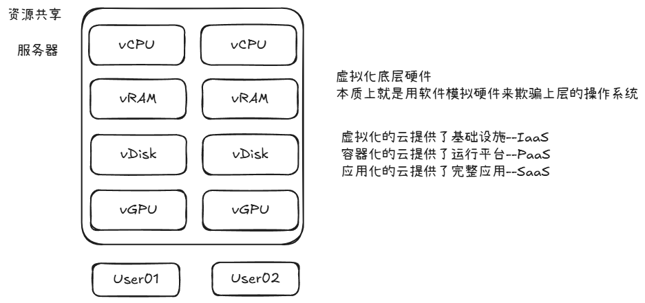

# KVM虚拟化技术

# 云计算介绍

## 简单介绍

### 什么是云计算

- 云计算就是一种特殊的网络服务。通过计算，存储等一系列先进技术能够给人们提供更加安全，便宜，高效，快捷的资源及应用的使用方式。



## 虚拟化方案

- VMWARE

- KVM（在电脑上模拟硬件，来建立apache或者其他环境）

- 采用虚拟化会对性能产生一定的损耗，但是提高了硬件的利用效率

### 半虚拟化和全虚拟化 

- 部分虚拟化

    - 一部分硬件如CPU一类采用虚拟化，而硬盘则不采用虚拟化直接接入

- 全虚拟化

    - 所有的环境都是虚拟化出来的，包括硬件

### Type1虚拟化和Type2虚拟化

- Type1类型也叫裸金属架构，这类虚拟化层直接运行在硬件之上，没有所谓的宿主机操作系统。他们直接控制硬件资源以及客户机。典型地如xen和vmware ESXI

- Type2类型也叫宿主机型架构，这类VMM通常就是宿主机操作系统上的一个应用程序，像其他应用程序一样受宿主机操作系统的管理，通常抽象为进程。例如，VMware workstation、KVM


### 硬件虚拟化

- 在虚拟机里面创建虚拟机，需要硬件满足硬件虚拟化，这是需要勾选vmware的选项


- 实际的生产环境不会采用虚拟化嵌套，因为性能会掉的很厉害

# KVM虚拟化技术简介

## KVM架构

- KVM内核模块

    - 它属于标准Linux内核的一部分，是一个专门提供虚拟化功能的模块，主要负责CPU和内存的虚拟化

- QEMU用户态工具

    - 它是一个普通的Linux进程，为客户机提供设备模拟的功能，包括模拟BIOS、数据总线、磁盘、网卡、显卡、声卡、键盘、鼠标等。

- 在KVM虚拟化架构下，每一个客户机就是一个QEMU进程，在一个宿主机上有多少个虚拟机就会有多少个QEMU进程；客户机中的每一个虚拟CPU对应QEMU进程中的一个执行线程；一个宿主机只有一个KVM内核模块，所有客户机都与这个内核模块进行交互。

## KVM上层管理工具

- libvirt

    - libvirt是使用最广泛的对KVM虚拟化进行管理的工具和应用程序接口，已经是事实上的虚拟化接口标准，后部分介绍的许多工具都是基于libvirt的API来实现的。

- virsh

    - virsh是一个常用的管理KVM虚拟化的命令行工具，对于系统管理员在单个宿主机上进行运维操作，virsh命令行可能是最佳选择。

- virt\-manager

    - virt\-manager是专门针对虚拟机的图形化管理软件，底层与虚拟化交互的部分仍然是调用libvirt API来操作的。

### 检查CPU是否支持虚拟化功能

`[root@``localhost`` ~]# cat /proc/cpuinfo |grep -E 'vmx|svm'`

- 如果有回复，证明支持虚拟化功能

- 没有回复，则证明不支持虚拟化功能 

## 环境准备

kvm有良好的图形化支持，所以我们可以先装一下桌面组件

1. 安装epel源并且更新系统中所有的软件包

```YAML
[root@localhost ~]# yum install -y epel-release
[root@localhost ~]# yum upgrade -y
```

2. 安装桌面软件包组

```YAML
[root@localhost ~]# yum grouplist
[root@localhost ~]# yum groupinstall -y "Server with GUI"
```

3. 启动图形化\(这一步要在虚拟机里面做\)

```YAML
#开机自动开启图形化
[root@localhost ~]# systemctl set-default graphical.target
#启动图形化
[root@localhost ~]# startx &
```

## KVM部署

### 清理环境

清理干净KVM相关的预装环境

```YAML
[root@localhost ~]# yum remove `rpm -qa |egrep 'qemu|virt|kvm'` -y
[root@localhost ~]# rm -rf /var/lib/libvirt /etc/libvirt/
```

### 安装KVM

```YAML
[root@localhost ~]# uname -r
5.14.0-570.26.1.el9_6.x86_64
[root@localhost ~]# cat /etc/rocky-release
Rocky Linux release 9.6 (Blue Onyx)
[root@localhost ~]# yum install qemu-kvm libvirt virt-manager virt-install bridge-utils virt-top libguestfs-tools bridge-utils virt-viewer -y
```

主要程序

- qemu\-KVM:主包

- libvirt:API接口

- virt\-manager:图形管理程序

在所谓的kvm技术中，应用到的其实有2个东西：qemu\+kvm

kvm负责CPU虚拟化\+内存虚拟化，实现了CPU和内存的虚拟化，但kvm不能模拟其他设备

qemu是模拟IO设备\(网卡，磁盘\)，kvm加上qemu之后就能实现真正意义上服务器的虚拟化

因为用到了上面两个东西所以一般都称之为qemu\-kvm

libvirt则是调用kvm虚拟化技术的接口用于管理的，用libvirt管理方便

## 启动服务

```YAML
[root@localhost ~]# systemctl start libvirtd
[root@localhost ~]# systemctl enable --now libvirtd
[root@localhost ~]# lsmod |grep kvm                # 查看kvm模块加载
kvm_intel             183621  0 
kvm                   586948  1 kvm_intel
irqbypass              13503  1 kvm
```

## 图形化中检查

在图形化命令行中输入`virt-manager`就可以看到kvm界面


# VT\-X打不开

## 关闭bitlocker


## ACE\-tools


[虚拟化修复\.zip](图片和附件/虚拟化修复.zip)

# GuestOS创建

- 通过KVM图形化安装（图形化）

- 通过Linux命令行安装（命令行）

- 通过Cockpit安装（网页版）

## 图形化创建

1. 上传ISO镜像到虚拟机中\(这里我采用的是xftp\)
这里的文件要下载在/var/lib/libvirt文件中，否则没有权限不允许安装


2. 打开KVM图形化

```YAML
[root@localhost ~]# virt-manager
```


3. 开始创建虚拟机


- 注意看这里是desktop的版本，下载其他版本可能报错


- CPU核心数适当拉高，可以提高下载速度


- 选上NAT可以联网


## Linux命令行创建

### 代码运行

有些情况下，没有图形化，这个时候就需要用到命令行创建虚拟机

1. 前置准备

需要关闭防火墙和SElinux

```XML
[root@localhost ~]# systemctl stop firewalld
[root@localhost ~]# setenforce 0
```

2. 安装virt\-install工具

```XML
[root@localhost ~]# yum -y install virt-install
[root@localhost ftp]# df -h
Filesystem           Size  Used Avail Use% Mounted on
devtmpfs             4.0M     0  4.0M   0% /dev
tmpfs                7.7G     0  7.7G   0% /dev/shm
tmpfs                3.1G  9.9M  3.1G   1% /run
/dev/mapper/rl-root   64G   21G   44G  32% /
/dev/nvme0n1p1       960M  370M  591M  39% /boot
/dev/mapper/rl-home   32G  255M   31G   1% /home
tmpfs                1.6G   84K  1.6G   1% /run/user/0
/dev/loop0            13G   13G     0 100% /var/ftp/rocky9
```

3. 本地源镜像安装（实际根据下载内容修改参数）

```XML
[root@localhost ~]# 
virt-install \
--connect qemu:///system \
--name ubuntu-24.04-1 \
--memory 4096 \
--vcpus 4 \
--disk path=/var/lib/libvirt/images/ubuntu-24.04-1.qcow2,size=20,bus=virtio \
--os-variant ubuntu24.04 \
--cdrom /var/lib/libvirt/ubuntu-24.04.4-live-server-amd64.iso \
--boot cdrom,hd,bootmenu.enable=on \
--graphics vnc,listen=0.0.0.0,port=5905,password='1' \
--noautoconsole
```

### 参数说明

- `-name=vm2`: 为虚拟机指定名称为 `vm2`

- `--ram 512`: 为虚拟机分配 512MB 内存

- `--vcpus=1`: 为虚拟机分配 1 个 vCPU

- `--disk path=/var/lib/libvirt/images/vm2.qcow2,size=5,bus=virtio`: 创建一个 5GB 大小、使用 virtio 总线的 QCOW2 格式虚拟磁盘文件 `/var/lib/libvirt/images/vm2.qcow2`

- `--cdrom /root/CentOS-7-x86_64-Minimal-1810.iso`: 指定本地 CentOS 7 Minimal ISO 作为安装介质

- `--vnc --vncport=-1 --vnclisten=0.0.0.0`: 启用 VNC 远程控制台,监听所有网络接口

- `--network bridge=virbr0,model=virtio`: 使用 `virbr0` 网桥并采用 virtio 网卡模型

- `--noautoconsole`: 不自动连接到虚拟机控制台

4. 在宿主机下访问

```Bash
[root@localhost ~]# virsh console vm1 
```

进去之后回车多次即可通过账号密码登录，退出执行`Ctrl+]`

### 注意事项

安装过程中均可默认通过，到了这一步的时候，需要将上面的镜像地址换成阿里云的镜像地址，可以加快安装速度


## cockpit创建

- 安装cockpit

```XML
[root@localhost ~]# yum install cockpit -y
[root@localhost ~]# yum -y install cockpit-machines
# 这个工具默认不允许root登录，所以需要开启一下
[root@localhost ~]# vim /etc/cockpit/disallowed-users    
#root
[root@localhost ~]# systemctl enable --now cockpit
```

- 访问9090端口


- 虚拟机模块需要安装


- 这里可以创建虚拟机


### 注意事项

- cockpit默认是不允许root用户进入的 

- 因此我们需要编辑`vim /etc/cockpit/disallowed-users`将里面的root注释掉

## 找不到 sshd\.service情况

1. 先检查是否安装了服务端

```XML
dpkg -l | grep openssh-server
```

2. 安装 openssh\-server（自动生成 sshd\_config）

```XML
sudo apt update
sudo apt install openssh-server -y
```

3. 修改permitrootlogin为yes

4. 最后记得输入`systemctl  restart  ssh`

## VNC远程连接

- 打开mobaxterm依次点击会话，VNC，填写具有GuestOS的主机IP，以及开启KVM对应的端口号


- 连接成功


# KVM基础管理

- 如果进去不是root，可以`sudo -i`提权

## 常用管理命令

```SQL
[root@localhost ~]# virsh list --all
[root@localhost ~]# virsh dumpxml vm1        # 查看虚拟机的配置
[root@localhost ~]# virsh dumpxml vm1 > vm1.xml.old
[root@localhost ~]# virsh edit vm1            # 编辑虚拟机
[root@localhost ~]# virsh start vm1            # 开启虚拟机
[root@localhost ~]# virsh suspend vm1        # 暂停虚拟机
[root@localhost ~]# virsh resume vm1        # 恢复虚拟机
[root@localhost ~]# virsh shutdown vm1        # 关闭虚拟机
[root@localhost ~]# virsh reboot vm1        # 重启虚拟机
[root@localhost ~]# virsh reset vm1                # 重置虚拟机
[root@localhost ~]# virsh undefine vm1        # 删除虚拟机
[root@localhost ~]# virsh autostart vm1        # 开机自启动虚拟机
[root@localhost ~]# virsh autostart --disable vm1        # 取消开机自动启动虚拟机
[root@localhost ~]# virsh list --all --autostart        # 查看所有开机自启动虚拟机
[root@localhost ~]# ls /etc/libvirt/qemu/autostart        # 有开机自动的虚拟机时自动创建
[root@localhost ~]# virsh destroy vm1        # 强行删除虚拟机，即使虚拟机是开启状态
```

## 虚拟机克隆

- 可以指定克隆之后的名字\(被克隆的机器需要关机\)

    - `virt-clone -o ubuntu-24.04-1 -n ubuntu-24.04-2 --auto-clone`

    - `virt-clone -o 被克隆机器名称 -n 克隆机器名称 --auto-clone`

## 虚拟机快照

- 快照就相当于一个还原点，可以看到qcow2的磁盘中有快照的存在

```YAML
[root@localhost ~]# virsh snapshot-create-as vm1 vm1.snap
已生成域快照 vm1.snap
[root@localhost ~]# qemu-img info /var/lib/libvirt/images/vm1.qcow2 
image: /var/lib/libvirt/images/vm1.qcow2
file format: qcow2
virtual size: 10G (10737418240 bytes)
disk size: 10G
cluster_size: 65536
Snapshot list:
ID        TAG                 VM SIZE                DATE       VM CLOCK
1         vm1.snap                  0 2020-10-02 15:10:06   00:00:00.000
Format specific information:
    compat: 1.1
    lazy refcounts: true
```

- 也可以单独查看虚拟机的快照

```XML
[root@localhost ~]# virsh snapshot-list vm1
 名称               生成时间              状态
------------------------------------------------------------
 vm1.snap             2020-10-02 15:10:06 +0800 shutoff
```

- 还原快照

```XML
[root@localhost ~]# virsh snapshot-revert vm1 vm1.snap
```

- 删除快照

```XML
[root@localhost ~]# virsh snapshot-delete --snapshotname vm1.snap vm1
已删除域快照 vm1.snap

[root@localhost ~]# virsh snapshot-list vm1
 名称               生成时间              状态
------------------------------------------------------------

```

# GuestOS修改配置

- 这些基本上都可以通过图形化的方式进行修改

## 添加磁盘

### 检查配置是否升级

```MATLAB
[root@localhost ~]# virsh console vm1

# 如果没有输出的话，检查是否控制台输出到串口（在子机上使用）
# vim /etc/default/grub
# GRUB_CMDLINE_LINUX="console=tty0 console=ttyS0,115200n8"
# update-grub
# systemctl enable serial-getty@ttyS0.service
# reboot
```

- 我们就可以在cockpit的界面，使用序列号的方式管理虚拟机了


- 这里的console界面只能连接一台设备（cockpit连上的话xshell使用指令连不上）

### 创建新的空磁盘卷

#### 方法1：命令行创建

```MATLAB
步骤 1：用 virsh vol-create-as 在 default 存储池新建磁盘卷（推荐！）
# 创建10G qcow2卷，自动归到default池，自动设置qemu权限
virsh vol-create-as default ubuntu-24.04-vdb.qcow2 10G --format qcow2
校验卷：
virsh vol-list default
步骤 2：编辑虚拟机 xml
virsh edit ubuntu24.04-1
把这段 disk 片段添加到<devices>标签内部，**删掉 address 那一行**
<disk type='volume' device='disk'>
  <driver name='qemu' type='qcow2' discard='unmap'/>
  <source pool='default' volume='ubuntu-24.04-vdb.qcow2'/>
  <target dev='vdb' bus='virtio'/>
</disk>
保存退出。
步骤 3：宿主机层面关机再开机（❗重要，虚拟机内部 reboot 不行）
virsh shutdown ubuntu24.04-1
# 等待虚拟机关闭，确认状态
virsh list --all
virsh start ubuntu24.04-1
步骤 4：虚拟机内验证
登录 Ubuntu
lsblk
```

#### 方法2：

- 使用cockpit完成添加硬盘


- 在线热插盘（物理方式直接插上去）

```MATLAB
virsh attach-disk ubuntu-22.04-1 /var/lib/libvirt/images/ubuntu-22.04-1-1.qcow2 vdb --subdriver qcow2 --persistent
```

## CPU添加

- 热添加的意思就是可以在虚拟机不重启的情况下，完成CPU的升级

- 不支持热减少

- GuestOS只支持Linux发行套件，不支持其他系统

```Bash
[root@localhost ~]# virsh edit vm1
<domain type='kvm'>
  <name>vm1</name>
  <uuid>b0c26bcd-ce6b-46ef-96e8-eb12ea52e5e0</uuid>
  <memory unit='KiB'>1048576</memory>
  <currentMemory unit='KiB'>1048576</currentMemory>
  <vcpu placement='auto' current='1'>4</vcpu>        # 最大cpu使用4个，默认是1个
# 改完这个配置后，必须要shutdown一下才可以生效
# 查看是否生效
[root@localhost ~]# virsh dumpxml ubuntu-22.04-1 | grep vcpu
  <vcpu placement='auto' current='1'>4</vcpu>
[root@localhost ~]# virsh vcpucount vm1
最大值    配置         4
当前       配置         1
[root@localhost ~]# virsh start vm1
域 vm1 已开始
[root@localhost ~]# virsh dominfo vm1    # 查看虚拟机的基本信息
Id:             2                                                        
名称：       vm1
UUID:           b0c26bcd-ce6b-46ef-96e8-eb12ea52e5e0
OS 类型：    hvm
状态：       running
CPU：          1                                                                # 可以看到目前只有一颗CPU
CPU 时间：   16.6s
最大内存： 1048576 KiB
使用的内存： 1048576 KiB
持久：       是
自动启动： 禁用
管理的保存： 否
安全性模式： none
安全性 DOI： 0
[root@localhost ~]# virsh setvcpus vm1 2 --live
[root@localhost ~]# virsh dominfo vm1
Id:             2
名称：       vm1
UUID:           b0c26bcd-ce6b-46ef-96e8-eb12ea52e5e0
OS 类型：    hvm
状态：       running
CPU：          2                                                        # 现在有两颗CPU
CPU 时间：   19.0s
最大内存： 1048576 KiB
使用的内存： 1048576 KiB
持久：       是
自动启动： 禁用
管理的保存： 否
安全性模式： none
安全性 DOI： 0
```

## 内存热添加

- 将最大可用内存调整为2048M

```XML
[root@localhost ~]# virsh edit vm1
<domain type='kvm'>
  <name>vm1</name>
  <uuid>b0c26bcd-ce6b-46ef-96e8-eb12ea52e5e0</uuid>
  <memory unit='KiB'>2097152</memory>                # 最大可用内存
  <currentMemory unit='KiB'>1048576</currentMemory>                # 内存当前大小
  <vcpu placement='auto' current='1'>4</vcpu>
```

- 重启虚拟机让其生效

```MATLAB
[root@localhost ~]# virsh reboot vm1
```

- 查看现在内存大小

```MATLAB
[root@localhost ~]# virsh qemu-monitor-command vm1 --hmp --cmd info balloon
balloon: actual=1024
```

- 调整内存到2048M

```MATLAB
[root@localhost ~]# virsh qemu-monitor-command vm1 --hmp --cmd balloon 2048
[root@localhost ~]# virsh qemu-monitor-command vm1 --hmp --cmd info balloon
balloon: actual=2048
```

### 注意

不推荐调整生产环境中的虚拟机内存，有崩溃的可能

# KVM存储

- kvm配置一个目录当做存储磁盘镜像\(存储卷\)的目录，这个目录为存储池

- 存储区域提前划分好，不用再找指定目录去存储

- 默认存储池：`/var/lib/libvirt/images/`

## 使用KVM存储池

为简化KVM存储管理的目的，可以创建存储池。在宿主机上创建存储池，可以简化KVM存储设备的管理。采用存储池的方式还可以实现对提前预留的存储空间的分配。这种策略对于大型应用环境很有效，存储管理员和创建虚拟机的管理经常不是同一个人。这样，在创建首台虚拟机之前先完成KVM存储池的创建是很好的方法。

## 存储池创建使用相关命令

存储池是一个由libvirt管理的文件、目录或存储设备，提供给虚拟机使用。存储池被分为存储卷，这些存储卷保存虚拟镜像或连接到虚拟机作为附加存储。libvirt通过存储池的形式对存储进行统一管理、简化操作。对于虚拟机操作来说，存储池和卷并不是必需的。

- 创建基于文件夹的存储池\(目录\)，并且定义存储池与其目录

```MATLAB
[root@localhost ~]# mkdir -p /data/vmfs
[root@localhost ~]# virsh pool-define-as vmdisk --type dir --target /data/vmfs
定义池 vmdisk·
```

- 创建已定义的存储池，然后查看已定义的存储池，存储池不激活无法使用

```SQL
# 构建池 vmdisk
[root@localhost ~]# virsh pool-build vmdisk

# 查看池
[root@localhost ~]# virsh pool-list --all
 名称               状态     自动开始
-------------------------------------------
 default              活动     是       
 vmdisk               不活跃  否       

# 启用存储池
[root@localhost ~]# virsh pool-start vmdisk
池 vmdisk 已启动

# 设置开机自动启动
[root@localhost ~]# virsh pool-autostart vmdisk
池 vmdisk 标记为自动启动

[root@localhost ~]# virsh pool-list --all
 名称               状态     自动开始
-------------------------------------------
 default              活动     是       
 vmdisk               活动     是
```

- 在存储池中创建虚拟机存储卷

```MATLAB
[root@localhost ~]# virsh vol-create-as vmdisk vm1-2.qcow2 10G --format qcow2
创建卷 vm1-2.qcow2
```

> 注1：KVM存储池主要是体现一种管理方式，可以通过挂载存储目录，LVM逻辑卷的方式创建存储池，虚拟机存储卷创建完成后，剩下的操作与无存储卷的方式无任何区别
> 
> 注2：KVM存储池也用于虚拟机迁移任务
> 
> 

## 存储池删除相关管理命令

- 在存储池中删除虚拟机存储卷

```MATLAB
[root@localhost ~]# virsh vol-delete --pool vmdisk vm1-2.qcow2
```

- 取消激活存储池

```MATLAB
[root@localhost ~]# virsh pool-destroy vmdisk
```

- 删除存储池定义的目录

```MATLAB
[root@localhost ~]# virsh pool-delete vmdisk
```

- 取消定义存储池

```MATLAB
[root@localhost ~]# virsh pool-undefine vmdisk
```

## 磁盘格式

- raw

    - 原始格式，性能最好 直接占用你一开始给多少 系统就占多少 不支持快照

- qcow

    - 性能远不能和raw相比，所以很快夭折了，所以出现了qcow2。（性能低下 早就被抛弃）

- qcow2

    - 性能上还是不如raw，但是raw不支持快照，qcow2支持快照。

### 写时拷贝\(copy on write\)

raw立刻分配空间，不管你有没有用到那么多空间 qcow2只是承诺给你分配空间，但是只有当你需要用空间的时候，才会给你空间。最多只给你承诺空间的大小，避免空间浪费

### 不同格式磁盘大小比较

- 可以看到qcow2的文件大小初始很小

```SQL
[root@localhost ~]# qemu-img create -f qcow2 test1.qcow2 1G
Formatting 'test1.qcow2', fmt=qcow2 size=1073741824 encryption=off cluster_size=65536 lazy_refcounts=off 
[root@localhost ~]# qemu-img create -f raw test2.raw 1G
Formatting 'test2.raw', fmt=raw size=1073741824 
[root@localhost ~]# ls -lh test1.qcow2 test2.raw 
-rw-r--r-- 1 root root 193K 10月  2 14:39 test1.qcow2
-rw-r--r-- 1 root root 1.0G 10月  2 14:39 test2.raw
```

## 虚拟机磁盘挂载至宿主机

- 当虚拟机无法启动的时候，可以将虚拟磁盘文件直接挂载到主机上，以获得其中的文件

- 查看磁盘镜像分区信息

```MATLAB
[root@localhost ~]# virt-df -h -d vm1
文件系统                            大小 已用空间 可用空间 使用百分比%
vm1:/dev/sda1                            1014M       100M       914M   10%
vm1:/dev/centos/root                      8.0G       971M       7.0G   12%
[root@localhost ~]# virt-filesystems -d vm1
/dev/sda1
/dev/centos/root        #这个是后续挂载的目录
```

- 挂载磁盘镜像分区，挂载完成之后可以看到vm1虚拟机根目录下的文件

```MATLAB
[root@localhost ~]# guestmount -d vm1 -m /dev/centos/root --rw /root/vm1
[root@localhost ~]# ls vm1/
bin   dev  home  lib64  mnt  proc  run   srv  tmp  var
boot  etc  lib   media  opt  root  sbin  sys  usr
```

- 取消挂载

```MATLAB
[root@localhost ~]# guestunmount /root/vm1
```

# 网络管理

- KVM有如下三种网络连接方式

    - nat

    - isolated

    - bridge

- 虚拟交换机

    - linux\-bridge\(linux自带\)

    - ovs\(open\-vswitch\)

扩展阅读，如果让netplan\(ubuntu2204默认的网络管理工具\)让给NetworkManager管理网络

```SQL
root@ubuntu:~# cat /etc/netplan/50-cloud-init.yaml 
network:
    renderer: NetworkManager
    ethernets:
        enp1s0:
            dhcp4: true
    version: 2
root@ubuntu:~# netplan apply
root@ubuntu:~# systemctl disable --now systemd-networkd
root@ubuntu:~# systemctl enable --now NetworkManager
root@ubuntu:~# nmcli device status
DEVICE  TYPE      STATE      CONNECTION 
enp1s0  ethernet  connected  enp1s0     
lo      loopback  unmanaged  --   
```

NAT网络拓扑

- 查看Linux网卡桥接

- NAT网络下

    - 宿主机和虚拟机可以互相访问

    - 虚拟机可以访问宿主机所在的物理网络

    - 宿主机所在的物理网络无法主动访问虚拟机

    ```MATLAB
    [root@localhost ~]# brctl show
    bridge name     bridge id               STP enabled     interfaces
    virbr0          8000.525400a816c6       yes             virbr0-nic
                                                            vnet0
    virbr1          8000.525400a15e56       yes             virbr1-nic
    
    ```


隔离网络拓扑

- 在隔离网络下

    - 虚拟机和宿主机可以互相访问

    - 宿主机不提供NAT功能，所以虚拟机与宿主机所在的物理网络无法互相访问


桥接网络拓扑

- 在桥接网络下

    - 虚拟机和宿主机可以互相访问

    - 虚拟机和宿主机同处于一个物理网络下

    - 物理网络可以直接访问虚拟机，虚拟机也可以直接访问物理网络


    ## 配置桥接网络
    
    在宿主机上，桥接自动获取IP地址
    
    - 注意，物理网卡在这样操作后，ens160就会被挂到br0桥下，原本ens160的IP地址会丢失，br0桥的虚拟接口会获得原本的IP。
    
    ```MATLAB
    nmcli connection add type bridge ifname br0 con-name br0
    nmcli connection modify br0 ipv4.method auto ipv6.method ignore
    
    nmcli connection add type ethernet ifname ens160 con-name br0-slave-ens160 master br0
    
    nmcli connection modify ens160 connection.autoconnect no
    nmcli connection modify br0-slave-ens160 no
    
    nmcli connection down ens160
    nmcli connection up br0
    nmcli connection up br0-slave-ens160
    ```

- 检查配置，如果虚拟机网卡没有挂到br0下，可以手动操作

- 删除原本virbr0桥上的vnet3网卡`brctl delif virbr0 vnet3` , 加到br0的网桥上`brctl addif br0 vnet3`

```YAML
[root@localhost ~]# brctl show
bridge name     bridge id               STP enabled     interfaces
br0             8000.000c292e48c6       yes             ens160
                                                        vnet3
docker0         8000.22698a118ebc       no              
virbr0          8000.525400b17117       yes             vnet2
```

- 修改虚拟机配置，然后启动虚拟机检查网络是否生效

```Bash
[root@localhost ~]# virsh edit vm1
<interface type='bridge'>
        <mac address='52:54:00:63:99:c1'/>
        <source bridge='br0'/>
        <model type='virtio'/>
        <address type='pci' domain='0x0000' bus='0x00' slot='0x03' function='0x0'/>
</interface>
```

检查：

- 使用本机电脑通过命令行ssh命令登录，可以连接到KVM虚拟机


删除桥接网卡步骤

- 删除br0的配置文件

    - 命令会断网导致连接断开，再虚拟机里面写代码

- 修改正常网卡的配置文件

```MATLAB
nmcli connection down br0-slave-ens160
nmcli connection down br0
nmcli connection delete br0-slave-ens160
nmcli connection delete br0

nmcli connection modify ens160 connection.autoconnect yes
nmcli connection up ens160
```

## 配置NAT网络

- 配置之前先删除桥接配置

- 复制默认的NAT网络配置

```MATLAB
[root@localhost ~]# cd /etc/libvirt/qemu/networks/
[root@localhost networks]# cp default.xml nat1.xml
```

- 修改配置文件

```XML
[root@localhost networks]# vim nat1.xml 
<network>
  <name>nat1</name>    # 名字也需要改
  <uuid>64fa0e8c-b799-4e27-8b23-7c4d512b50e7</uuid>    # uid需要改一下
  <forward mode='nat'/>
  <bridge name='virbr1' stp='on' delay='0'/>    # 网桥名字不能和复制的一样
  <mac address='52:54:00:8a:1e:8c'/>    # mac地址需要修改
  <ip address='192.168.66.1' netmask='255.255.255.0'>    # 自己随便写一个
    <dhcp>
      <range start='192.168.66.2' end='192.168.66.254'/>    # dhcp分配范围
    </dhcp>
  </ip>
</network>
```

- 重启`libvirtd`服务，然后激活新的nat网络

```SQL
[root@localhost networks]# systemctl restart libvirtd
# 持久定义不启动，重启宿主机网络定义还在，需要手动 net-start
[root@localhost networks]# virsh net-define nat1.xml
[root@localhost ~]# virsh net-autostart nat1
网络nat1标记为自动启动
[root@localhost ~]# virsh net-start nat1
网络 nat1 已开始
[root@localhost ~]# virsh net-list
 名称               状态     自动开始  持久
----------------------------------------------------------
 default              活动     是           是
 nat1                 活动     是           是
```

- 修改虚拟机配置，然后启动虚拟机检查网络是否生效

```Bash
[root@localhost ~]# virsh edit vm1
<interface type='network'>
  <mac address='52:54:00:63:99:c1'/>
  <source network='nat1'/>
  <model type='virtio'/>
  <address type='pci' domain='0x0000' bus='0x00' slot='0x03' function='0x0'/>
</interface>
```

- 检查

    - 虚拟机的IP地址更改了


## 注意

这个部分相当于把物理网卡和虚拟网卡都归到一个虚拟网卡（类似于交换机），此时通过桥接模式，主机和虚拟机都处于一个网的影响下，可以通过主机cmd来连接虚拟机了

mac地址，uid，网卡名字和配置名字需要更改

## 配置隔离网络

复制默认的NAT网络配置

```Bash
[root@localhost ~]# cd /etc/libvirt/qemu/networks/
[root@localhost networks]# cp default.xml isolate1.xml
```

修改配置文件

和创建NAT网络一样，不过需要额外的在配置文件中删除如下一行

```Bash
[root@localhost networks]# vim isolate1.xml 
<forward mode='nat'/>
```

重启`libvirtd`服务，然后激活新的nat网络

```Bash
[root@localhost networks]# systemctl restart libvirtd
[root@localhost networks]# virsh net-define isolate1.xml
[root@localhost ~]# virsh net-autostart isolate1
网络isolate1标记为自动启动
[root@localhost ~]# virsh net-start isolate1
网络 isolate1 已开始
[root@localhost ~]# virsh net-list
 名称               状态     自动开始  持久
----------------------------------------------------------
 default              活动     是           是
 isolate1             活动     是           是
 nat1                 活动     是           是
```

修改虚拟机配置，然后启动虚拟机检查网络是否生效

```Bash
[root@localhost ~]# virsh edit vm1
<interface type='network'>
  <mac address='52:54:00:63:99:c1'/>
  <source network='isolate1'/>
  <model type='virtio'/>
  <address type='pci' domain='0x0000' bus='0x00' slot='0x03' function='0x0'/>
</interface>
```

- 隔离网络的虚拟机，网络是不通的


- 我们可以在cockpit界面中通过切换网口，选择不同的网络连接模式


## virbr0网卡

virbr0是kvm默认创建的一个Bridge，其作用是为连接其上的虚拟机网卡提供DHCP功能

virbr0默认分配一个IP `192.168.122.1`，并为连接其上的其他虚拟机网卡提供网关和DHCP功能

virbr0使用dnsmasq提供DHCP服务

```Bash
[root@localhost ~]# ps -elf |grep dnsmasq5 S nobody     1325      1  0  80   0 - 13475 poll_s 16:02 ?        00:00:00 /usr/sbin/dnsmasq --conf-file=/var/lib/libvirt/dnsmasq/default.conf --leasefile-ro --dhcp-script=/usr/libexec/libvirt_leaseshelper
```

在`/var/lib/libvirt/dnsmasq/`目录下有一个virbr0\.status文件，里面记录了所有获得IP的记录

```Bash
[root@localhost ~]# cat /var/lib/libvirt/dnsmasq/virbr0.status 
    [{"ip-address": "192.168.122.232",
    "mac-address": "52:54:00:37:68:dc",
    "hostname": "vm1",
    "expiry-time": 1601891907}]
```


